# 9.1 - Moving Workpieces Using Workspace Switching

## 1) Overview

This chapter explains the task of using two workspaces where the robot picks up workpieces coming into the input space, processes them, and then transfers them to the output space. Through this, you can learn the basic usage of safety functions and safety communication.

If a person is in the input space, the robot can only operate within the output space, and if a person is in the output space, the robot can only operate within the input space. Additionally, if the robot goes beyond the allowed workspace (inside the fence), it immediately stops due to the safety function.

In this example, whether a person enters each workspace is detected through two safety mats installed on the floor, and the detected signal is transmitted to the robot controller through safety communication. This example explains how to switch the robot's safety monitoring area according to the transmitted safety signals.

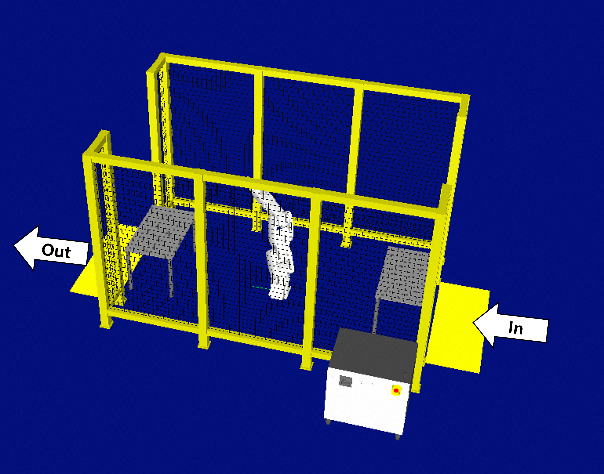</img>
<em>
[Workspace Diagram]
</em>

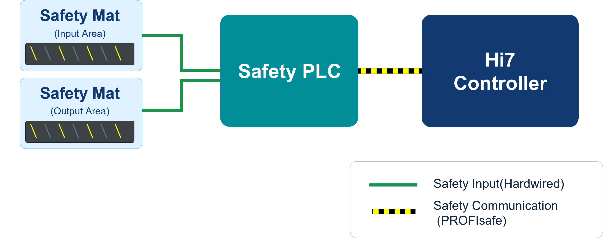</img>
<em>
[Safety Mat Safety Communication Connection]
</em>

***[Overall Setup Sequence]***

1. Robot link settings
2. Tool settings
3. Safety I/O settings
4. Workspace settings



Overall settings are done through HRSafeSpace2. All settings can also be done through the TP.

"[HRSafeSpace2](https://hrbook-hrc.web.app/#/view/doc-hrsafespace2/ko/README)"



### Step 1) Robot Link Settings

Select Layout->robot in HRSafeSpace2.  
Refer to the figure below and enter values for links 2 and 3.  
When you click the `[Save]` button, you can check changes in capsule size and position in the preview screen.

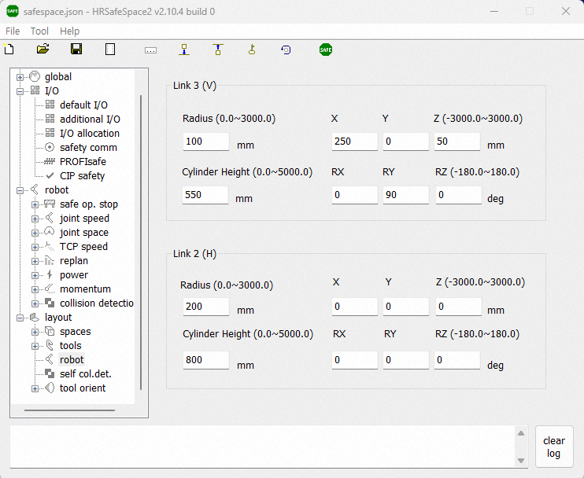</img>
<em>
Robot link settings screen
</em>

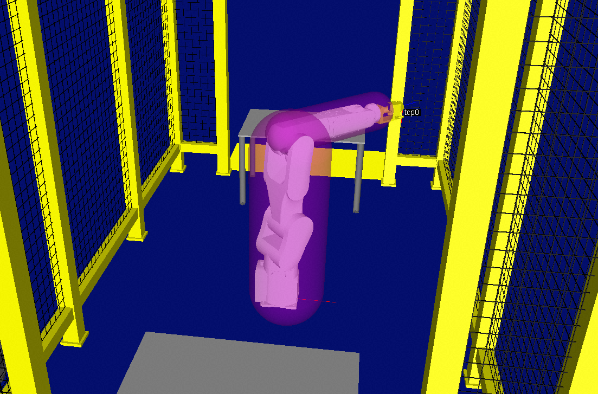</img>
<em>
Robot link settings preview
</em>

### Step 2) Tool Settings

Select Layout->tools->tool0 in HRSafeSpace2.  
The shape of each tool number can be configured by combining up to 10 models. Refer to the figure below and enter the shape of Model 0.  
When you click the `[Save]` button, you can check changes in capsule size and position in the preview screen.

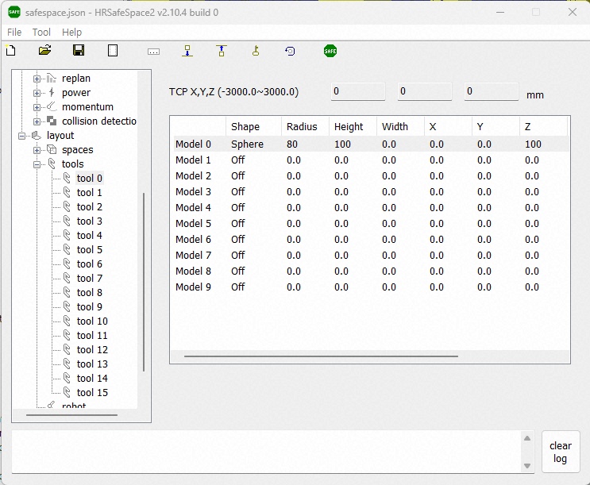</img>
<em>
Tool settings screen
</em>

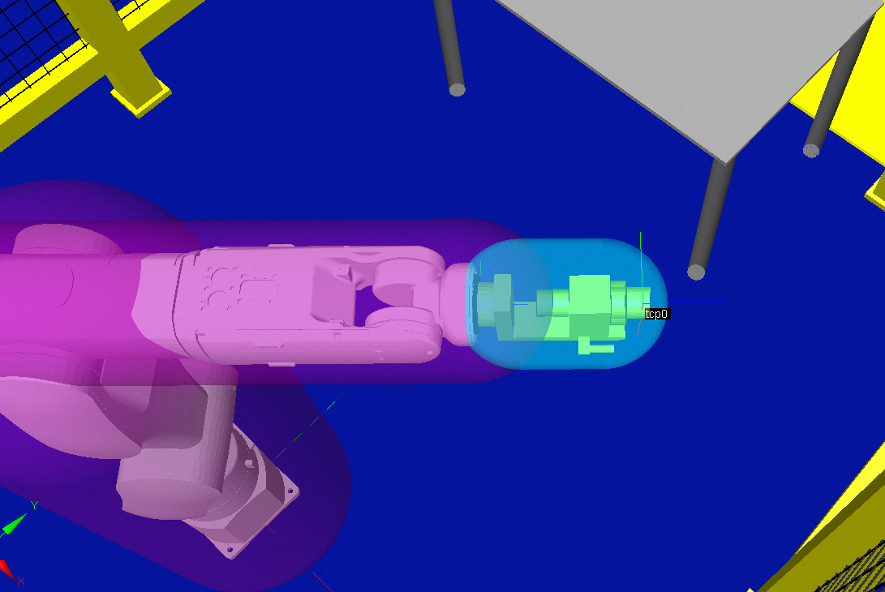</img>
<em>
Tool settings preview
</em>

### Step 3) Safety I/O Settings
Select I/O->I/O allocation in HRSafeSpace2.  
To activate space1 and space2 through signals input via safety communication, refer to the screen below and configure the Safety comm.input and Safety comm.output settings.

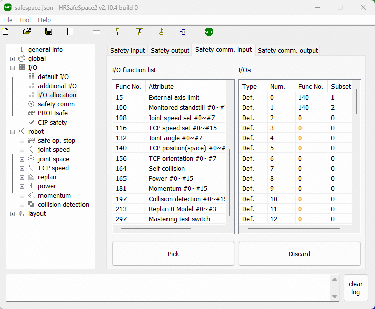</img>
<em>
Safety signal assignment (safety communication input)
</em>

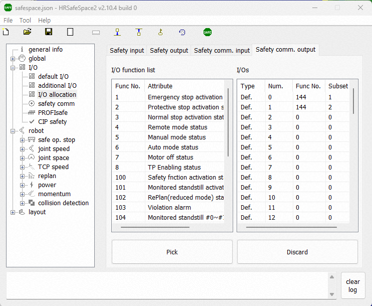</img>
<em>
Safety signal assignment (safety communication output)
</em>

input bit 0 (exit-side safety mat) : space 1 (input space) activation (0: activated, 1: deactivated) 
input bit 1 (entrance-side safety mat) : space 2 (output space) activation (0: activated, 1: deactivated) 

output bit 0 : space 1 (input space) (0: area violation, 1: no area violation) 
output bit 1 : space 2 (output space) (0: area violation, 1: no area violation) 

If a person is on the exit-side safety mat, the input space is set as the workspace.  
If a person is on the entrance-side safety mat, the output space is set as the workspace.

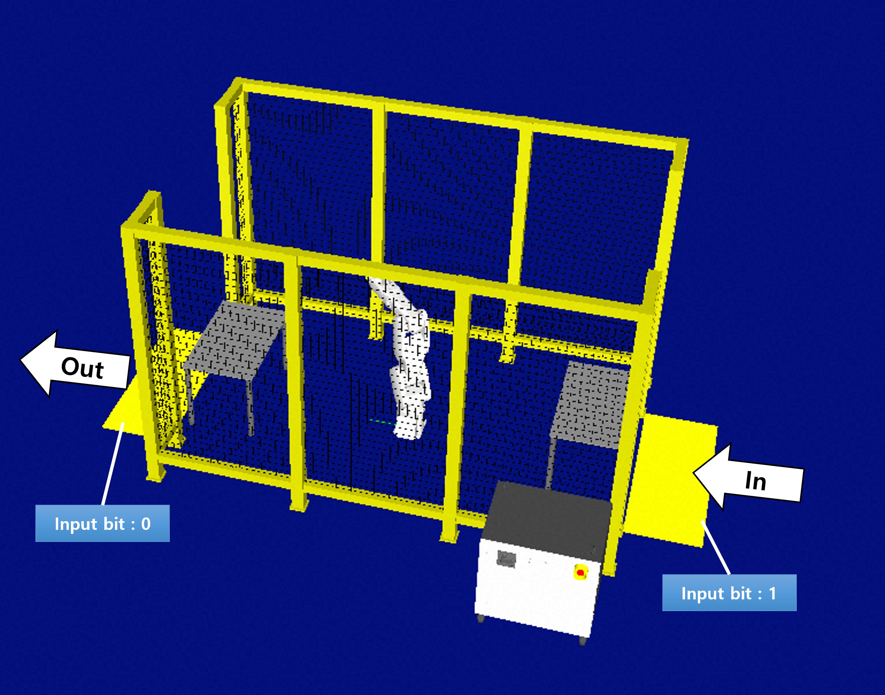</img>
<em>
Safety signal assignment (mat)
</em>

- Through the panel selection window, you can check the **safety communication input settings and status**.

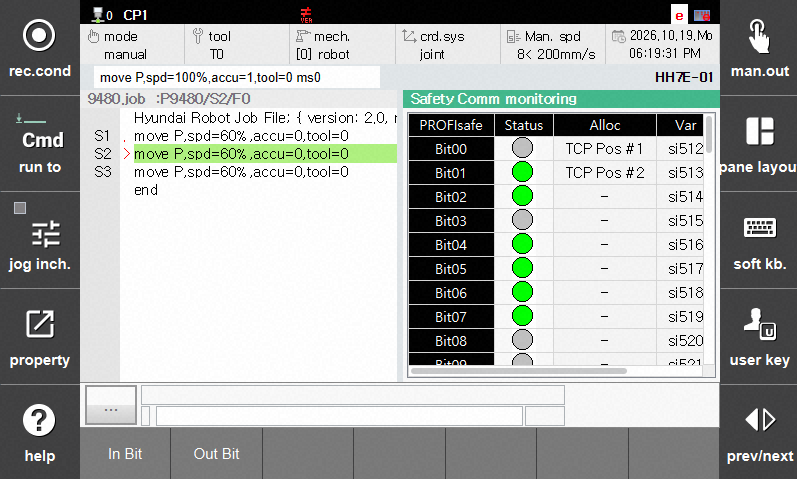</img>
<em>
Safety communication input monitoring
</em>

- Through the panel selection window, you can check the **safety communication output settings and status**.

</img>
<em>
Safety communication output monitoring
</em>

### Step 4) Workspace Settings

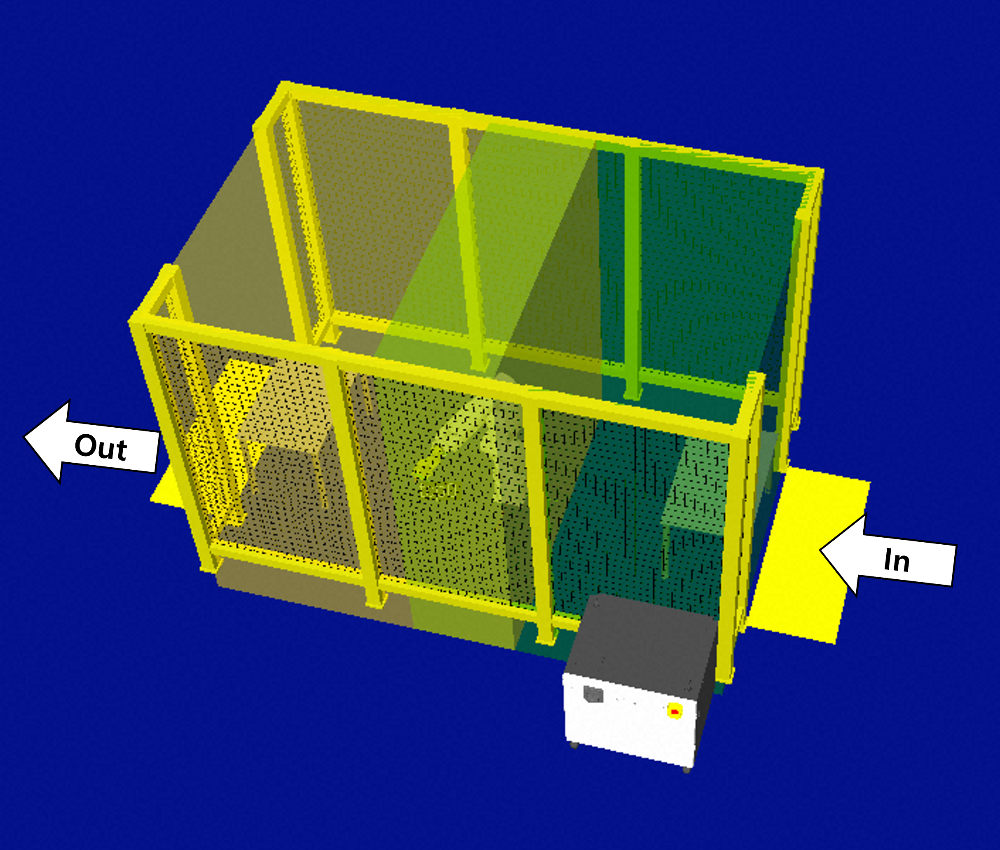</img>
<em>
Space overall preview
</em>

4.1) Fence Area Settings (Space 0)

Select Layout->spaces->space 0 in HRSafeSpace2. 
Set Space 0 as the internal space of the fence. Set it so that the robot body or tool can stop immediately before exiting this space.

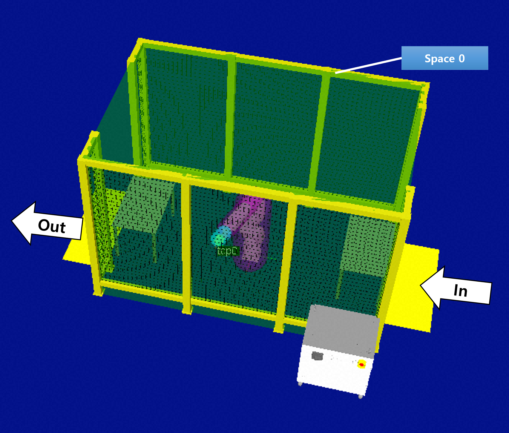</img>
<em>
Space 0 preview
</em>

[General Tab Settings]

|  **Function** |     **Setting Value**   |   **Description**   |
| :-------: | :---------------: | :---------------: |
| Activation | Always ON | Always remains in an activated state |
| Stop Function | Stop 0 | Immediately stops and motor off when target exceeds the set range |
| Type | Workspace | Set as workspace |

 

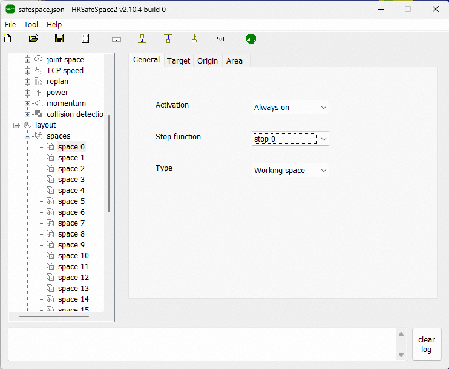</img>
<em>
Space 0 general settings
</em>

[Target Settings]

Set the space monitoring target to **Tool + Lower Arm + Upper Arm**.

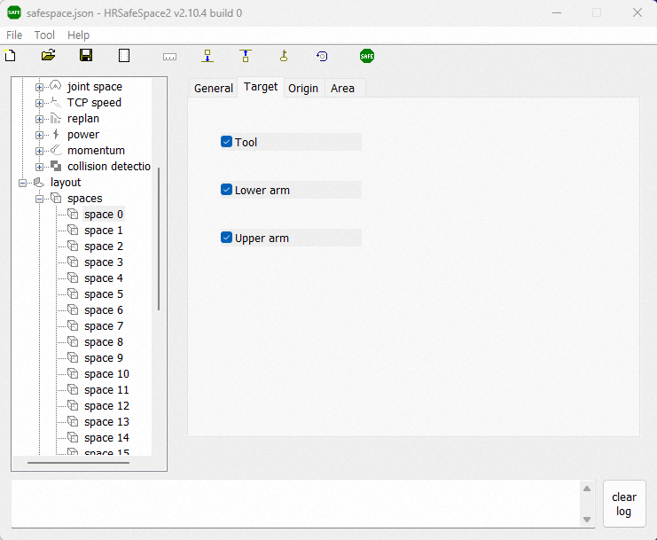</img>
<em>
Space 0 target settings
</em>

[Origin Settings]  
Do not change.

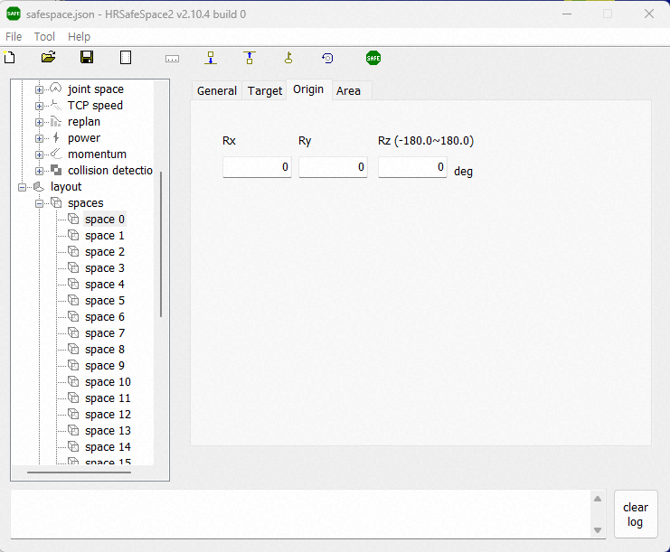</img>
<em>
Space 0 origin settings
</em>

[Area Setting Method]

There are two methods for setting the area.  
① Enter coordinates directly  
② Press the input start button to click X, Y coordinates directly on the HRSpace screen, then set the z min & max values

Refer to the figure below to set the working area.

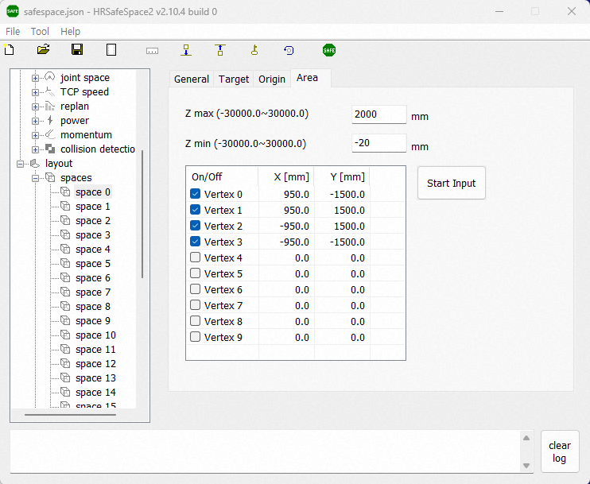</img>
<em>
Space 0 area settings
</em>

4.2) Input Space Settings (Space 1)

Select Layout->spaces->space 1 in HRSafeSpace2. 
Space 1 sets the right input space in the diagram. When a person is on the left safety mat, the right input space is activated, and if the robot or tool exits this space, the robot decelerates and stops.

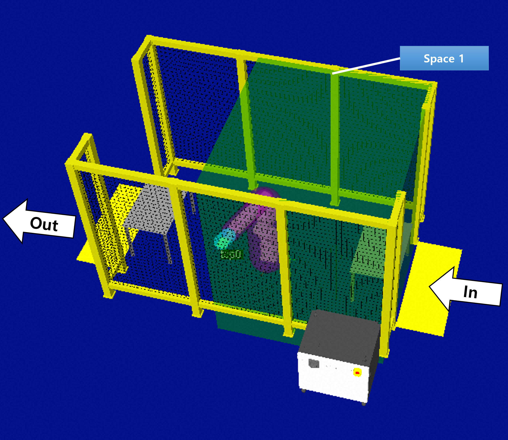</img>
<em>
Space 1
</em>

[General Tab Settings]

|  **Function** |     **Setting Value**   |   **Description**   |
| :-------: | :---------------: | :---------------: |
| Activation | Safety Signal | Activated when safety signal input becomes 0, deactivated when it becomes 1 |
| Stop Function | Stop 1 | Deceleration stop and motor off when target exits the workspace |
| Type | Workspace | Set as workspace |

 

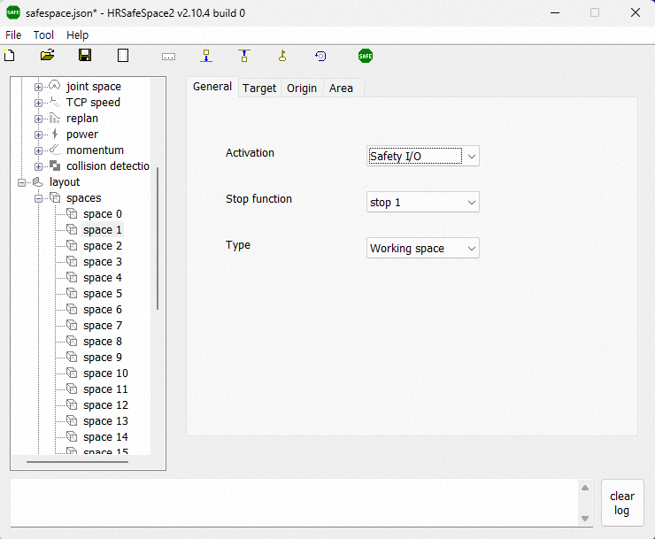</img>
<em>
Space 1 general settings
</em>

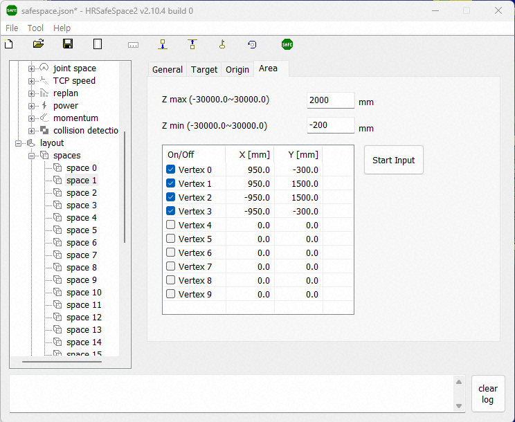</img>
<em>
Space 1 area settings
</em>

4.3) Output Space Settings (Space 2)

Select Layout->spaces->space 2 in HRSafeSpace2. 
Space 2 sets the left output space in the diagram. When a person is on the right safety mat, the left output space is activated, and if the robot or tool exits this space, the robot decelerates and stops.

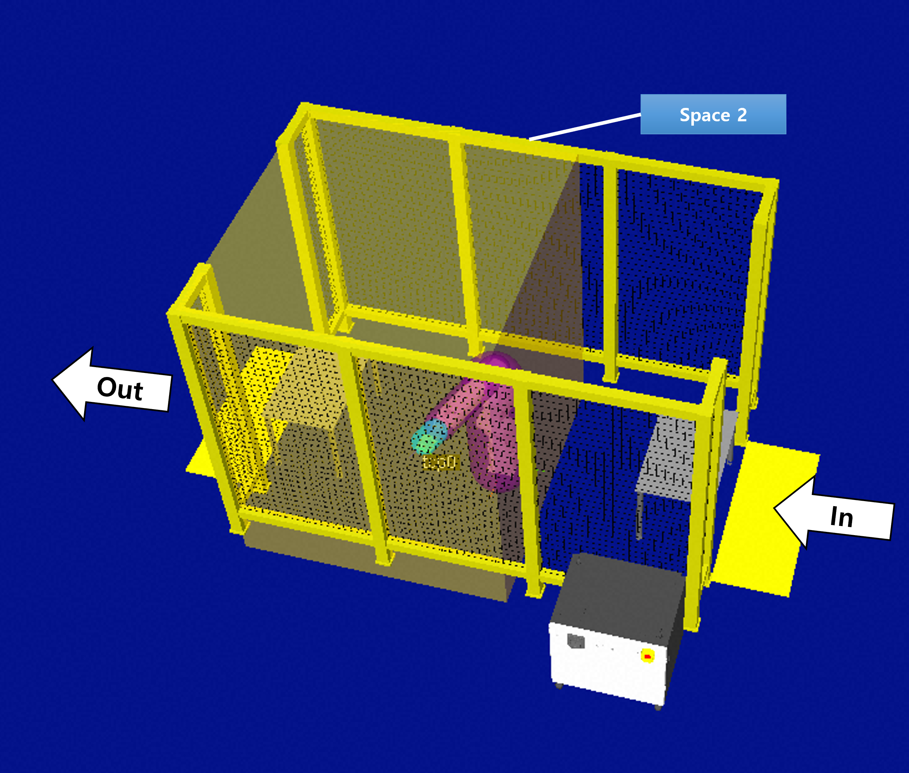</img>
<em>
Space 2
</em>

[General Tab Settings]

|  **Function** |     **Setting Value**   |   **Description**   |
| :-------: | :---------------: | :---------------: |
| Activation | Safety Signal | Activated when safety signal input becomes 0, deactivated when it becomes 1 |
| Stop Function | Stop 1 | Deceleration stop and motor off when target exits the workspace |
| Type | Workspace | Set as workspace |

 

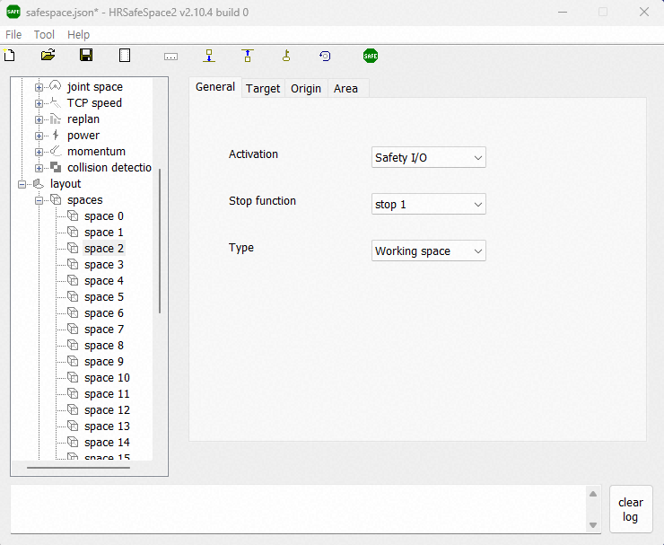</img>
<em>
Space 2 general settings
</em>

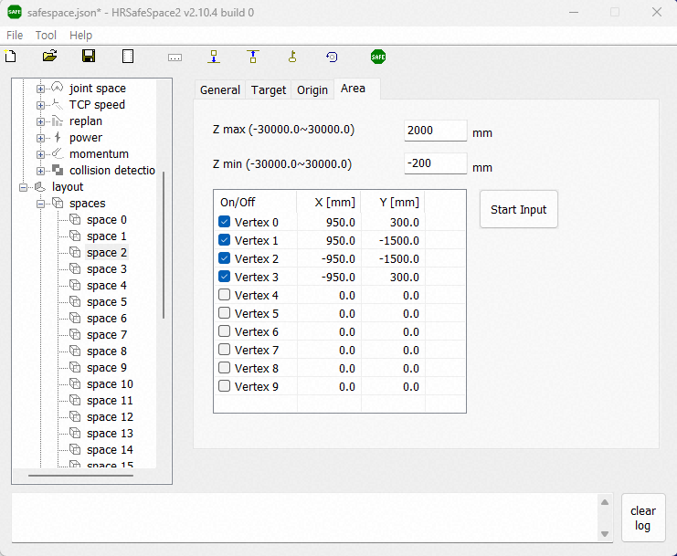</img>
<em>
Space 2 area settings
</em>

