# 9.1 - 작업 공간 전환을 활용한 작업물 이동

## 1) 개요

이번 장에서는 두 개의 작업 공간을 활용하여 입력 공간으로 들어오는 작업물을 로봇이 취출하고, 가공한 뒤 출력 공간으로 이송하는 작업을 설명합니다. 이를 통해 안전 기능 및 안전 통신의 기본적인 사용 방법을 익힐 수 있습니다.

입력 공간에 사람이 있는 경우 로봇은 출력 공간 내에서만 동작할 수 있으며, 출력 공간에 사람이 있는 경우에는 로봇은 입력 공간 내에서만 동작할 수 있습니다. 또 로봇이 허용된 작업 공간(펜스 내부)을 벗어나는 경우 안전기능에 의해 즉시 정지합니다.

이번 예에서 작업 공간별 사람의 진입 여부는 바닥에 설치된 두 개의 안전 매트를 통해 감지하며, 감지된 신호는 안전 통신을 통해 로봇 제어기로 전달됩니다. 본 예제에서는 전달된 안전신호에 따라 로봇의 안전 감시 영역을 전환하는 방법을 설명합니다.

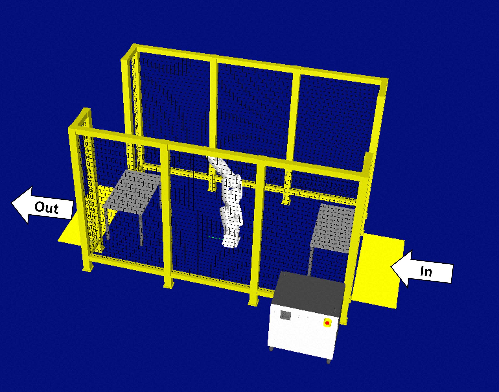</img>
<em>
[작업 공간 그림]
</em>

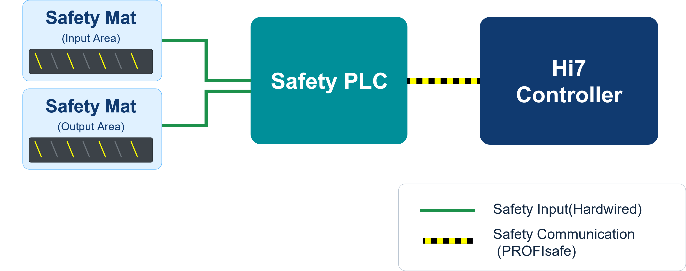</img>
<em>
[안전 매트 안전통신 연결]
</em>

***[전체 설정 순서]***

1. 로봇 링크의 설정
2. 톨의 설정
3. Safety I/O의 설정
4. 작업 공간의 설정



전체적인 설정은 HRSafeSpace2를 통해 이루어집니다. 모든 설정은 TP를 통해서도 가능하니 이점 참고하시고 아래 메뉴얼을 참고해 주십시오.

"[HRSafeSpace2](https://hrbook-hrc.web.app/#/view/doc-hrsafespace2/ko/README)"



### Step 1) 로봇 링크의 설정

HRSafeSpace2에서 Layout->robot을 선택합니다.  
아래 그림을 참고하여 링크 2, 3에 대한 수치를 입력합니다.  
`[저장]` 버튼을 클릭하면, 미리 보기 화면에서 캡슐 크기와 위치 변화를 확인할 수 있습니다.

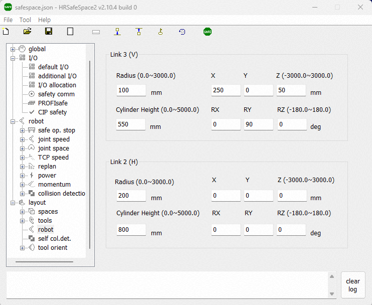</img>
<em>
로봇 링크 설정 화면
</em>

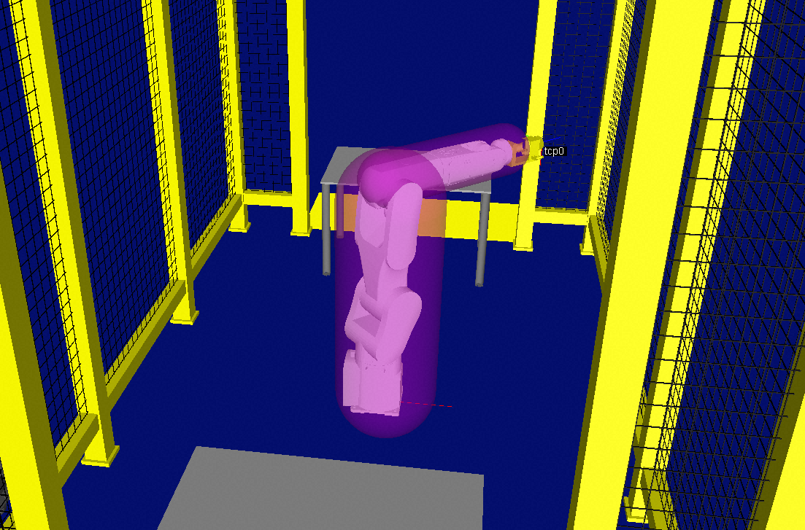</img>
<em>
로봇 링크 설정 미리 보기
</em>

### Step 2) 툴의 설정

HRSafeSpace2에서 Layout->tools->tool0을 선택합니다.  
각 툴 번호의 형상은 최대 10개의 모델을 조합하여 구성할 수 있습니다. 아래 그림을 참고하여 Model 0의 형상을 입력합니다.  
`[저장]` 버튼을 클릭하면, 미리 보기 화면에서 캡슐 크기와 위치 변화를 확인할 수 있습니다.

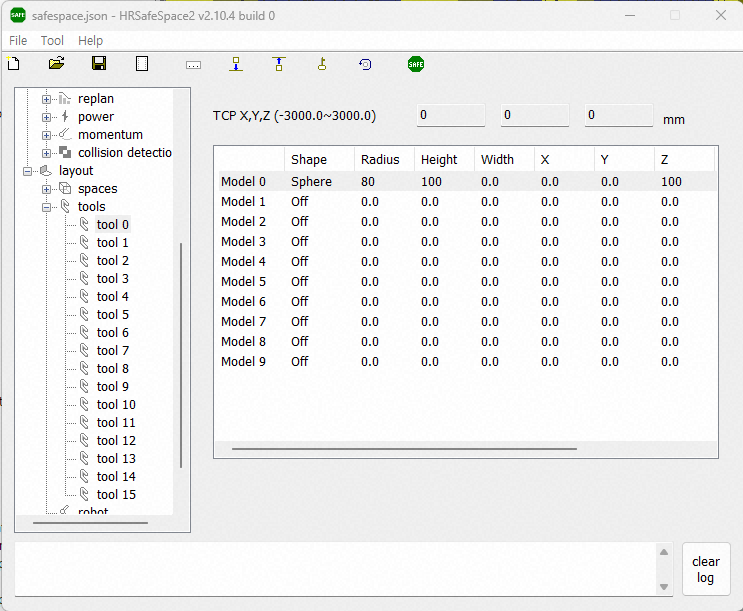</img>
<em>
툴 설정 화면
</em>

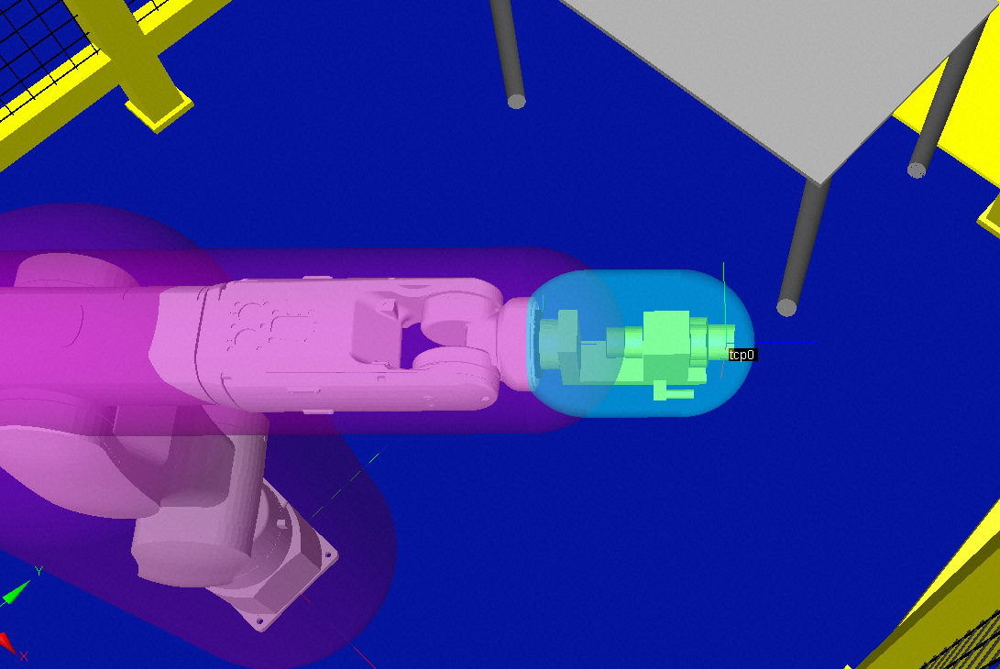</img>
<em>
툴 설정 미리 보기
</em>

### Step 3) Safety I/O의 설정
HRSafeSpace2에서 I/O->I/O allocation을 선택합니다.  
안전 통신을 통해 입력되는 신호를 통해 space1, space2를 활성화하려면 아래 화면을 참고하여 Safety comm.input 과 Safety comm.output 설정을 합니다.

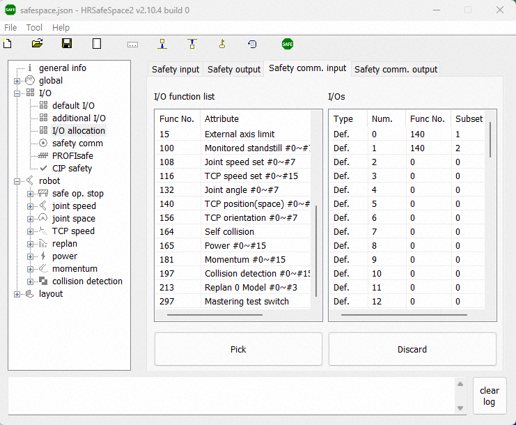</img>
<em>
안전 신호 할당 (안전 통신 입력)
</em>

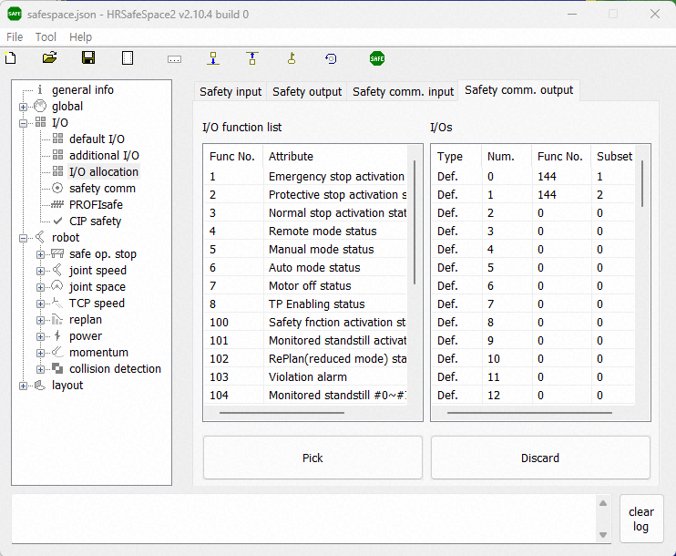</img>
<em>
안전 신호 할당 (안전 통신 출력)
</em>

input bit 0 (출구쪽 안전매트) : space 1 (입구 공간) 활성화 (0: 활성화, 1: 비활성화) 
input bit 1 (입구쪽 안전매트) : space 2 (출구 공간) 활성화 (0: 활성화, 1: 비활성화) 

output bit 0 : space 1 (입력공간) (0: 영역위반, 1: 영역위반 없음) 
output bit 1 : space 2 (출력공간) (0: 영역위반, 1: 영역위반 없음) 

출구쪽 안전매트에 사람이 있으면 입구 공간이 작업공간으로 설정되고  
입구쪽 안전매트에 사람이 있으면 출구 공간이 작업공간으로 설정됩니다.

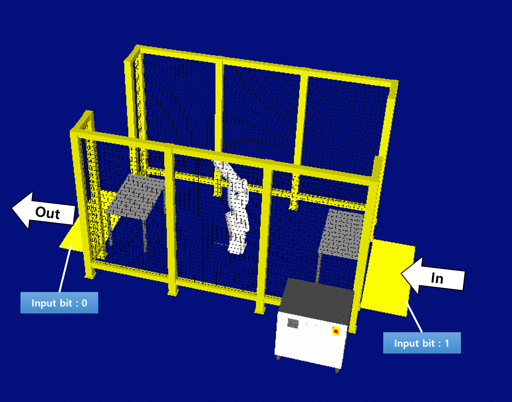</img>
<em>
안전 신호 할당 (매트)
</em>

- 패널 선택창을 통해 **안전 통신 입력의 설정 및 상태**를 확인할 수 있습니다.

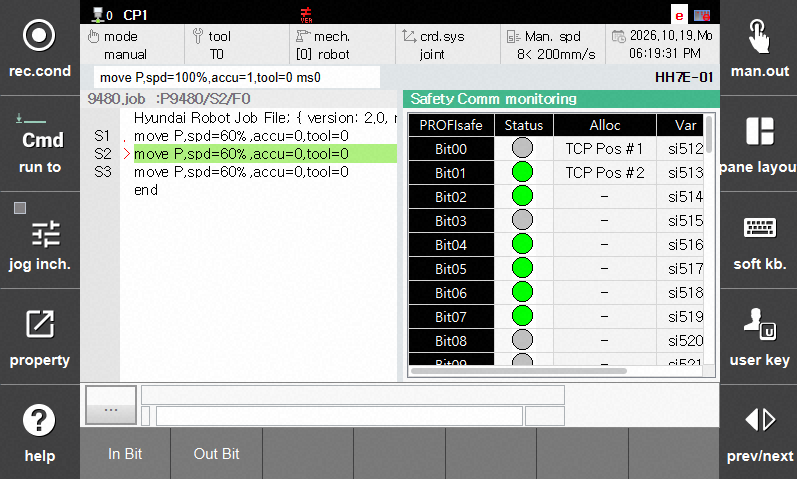</img>
<em>
안전 통신 입력 모니터링
</em>

- 패널 선택창을 통해 **안전 통신 출력의 설정 및 상태**를 확인할 수 있습니다.

</img>
<em>
안전 통신 출력 모니터링
</em>

### Step 4) 작업 공간의 설정

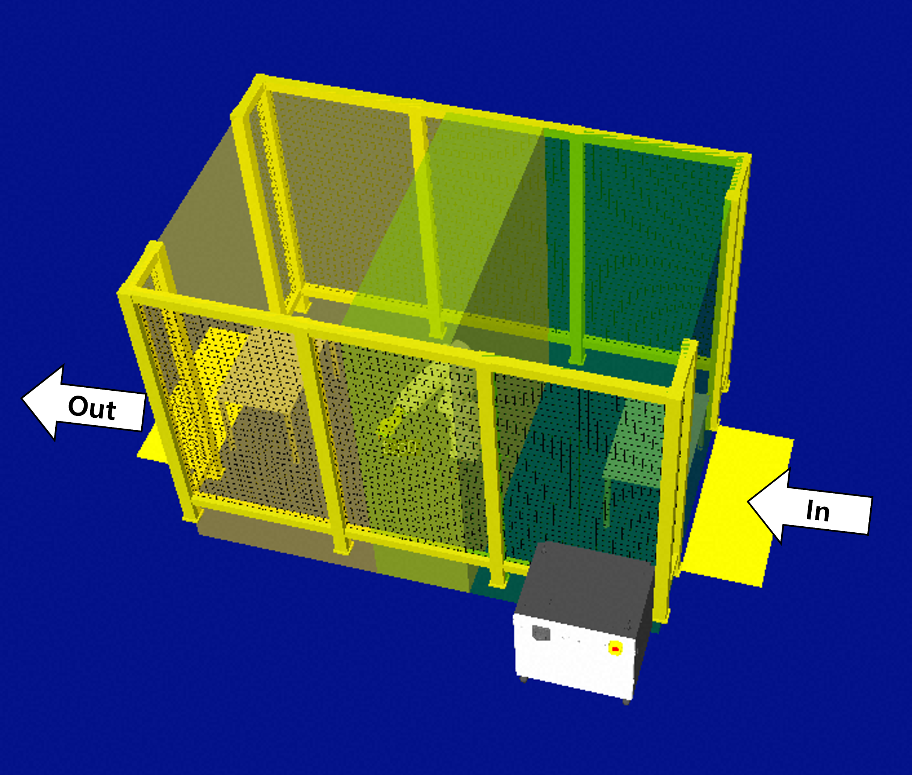</img>
<em>
space 전체 미리 보기
</em>

4.1) 펜스 영역 설정 (영역 0)

HRSafeSpace2에서 Layout->spaces->space 0을 선택합니다. 
Space 0을 펜스 내부 공간으로 설정합니다. 로봇 몸체나 툴이 이 공간을 벗어나기 전 즉시 멈출 수 있도록 설정합니다.

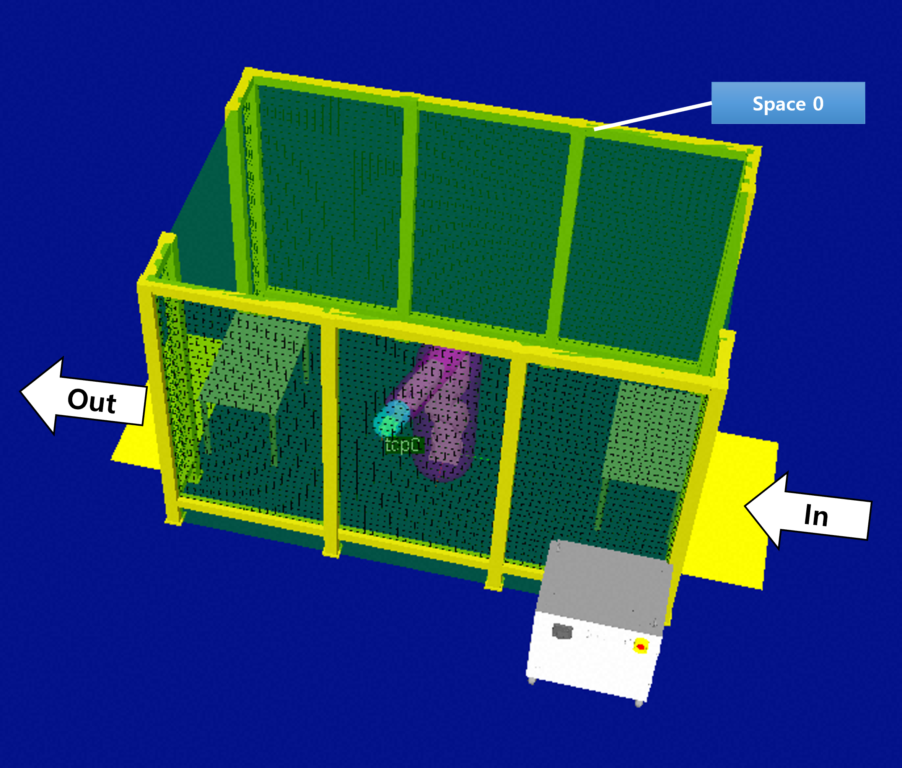</img>
<em>
space 0 미리 보기
</em>

[일반 탭의 설정]

|  **기능** |     **설정 값**   |   **설명**   |
| :-------: | :---------------: | :---------------: |
| 활성화 | 항상 ON | 항상 활성화 상태를 유지|
| 정지 기능 | Stop 0 | 타겟이 설정된 범위를 넘어서는 순간 즉시 정지 후 모터 오프|
| 타입 | 작업 공간 | 작업공간으로 설정|

 

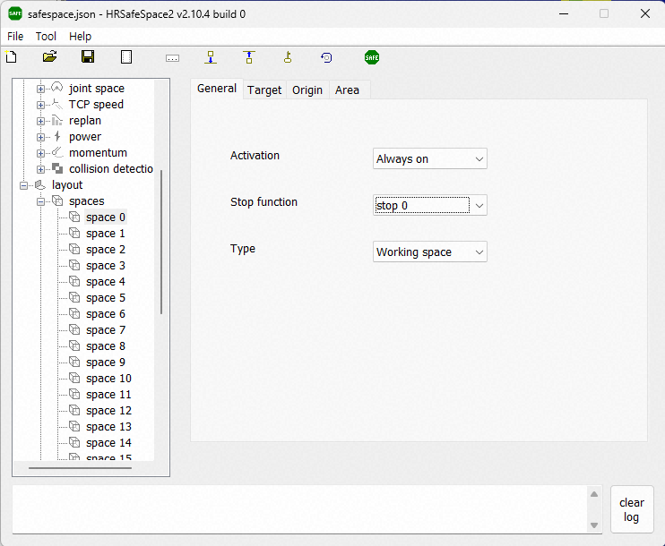</img>
<em>
space 0 일반 설정
</em>

[타겟의 설정] 

공간 감시 타겟을 **툴 + 하부 암 + 상부 암** 으로 설정 한다.

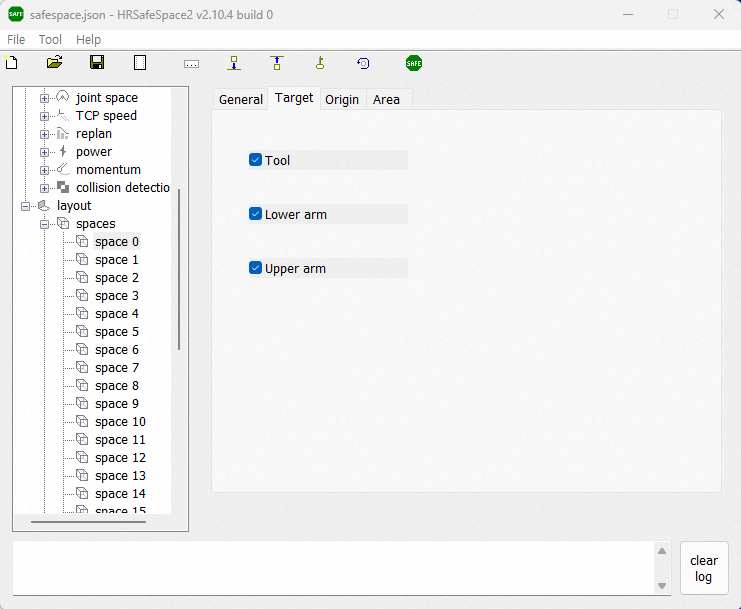</img>
<em>
space 0 타겟 설정
</em>

[원점의 설정]  
변경하지 않는다.

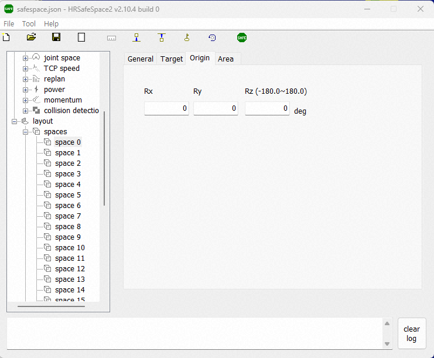</img>
<em>
space 0 원점 설정
</em>

[영역 설정의 방법]

영역을 설정하는 방법은 두가지가 있습니다.  
① 좌표를 직접 입력  
② 입력 시작 버튼을 눌려 X,Y 좌표를 HRSpace 화면에서 직접 마우스 클릭 후 z min & max 값 설정

아래 그림을 참고하여 작업 영역을 설정합니다.

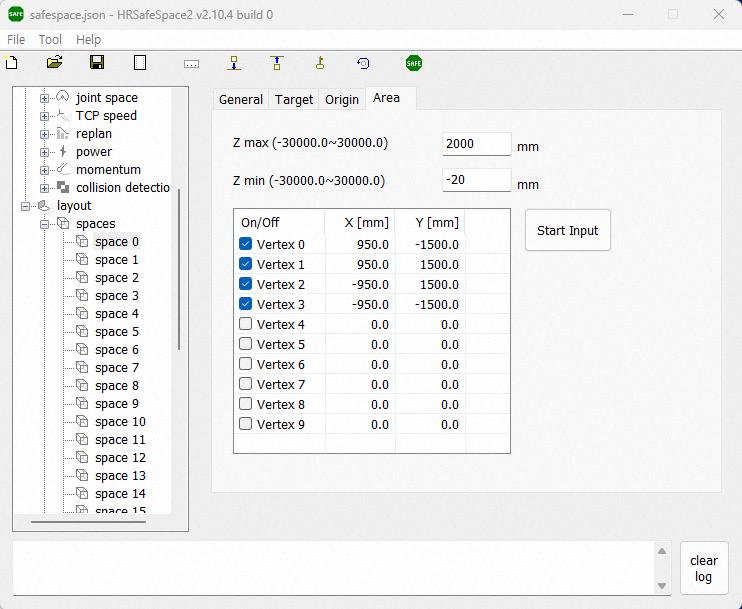</img>
<em>
space 0 영역 설정
</em>

4.2) 입구 공간의 설정 (영역 1)

HRSafeSpace2에서 Layout->spaces->space 1을 선택합니다. 
Space 1는 그림상 오른쪽 입구 공간을 설정합니다. 왼쪽 안전 매트에 사람이 있는 경우 오른쪽 입구 공간이 활성화 되며 로봇이나 툴이 이 공간을 벗어나면 로봇은 감속하여 정지합니다.

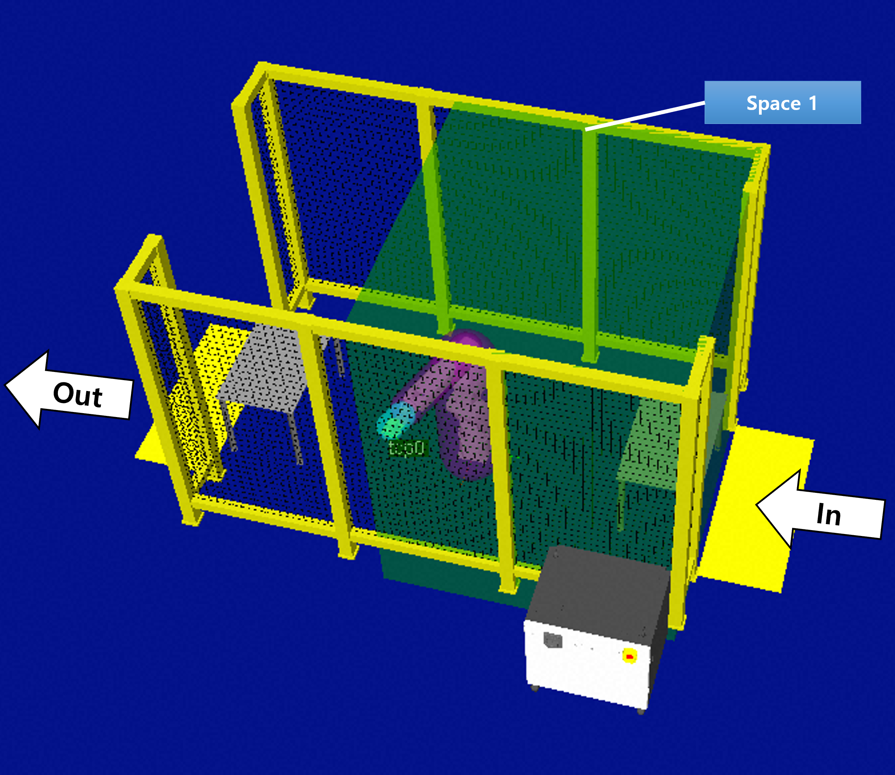</img>
<em>
space 1
</em>

[일반 탭의 설정]

|  **기능** |     **설정 값**   |   **설명**   |
| :-------: | :---------------: | :---------------: |
| 활성화 | 안전 신호 | 안전신호의 입력이 0이 되면 활성화, 1이 되면 비활성화|
| 정지 기능 | Stop 1 | 타겟이 작업공간을 벗어나면 감속 정지 후 모터오프|
| 타입 | 작업 공간 | 작업공간으로 설정|

 

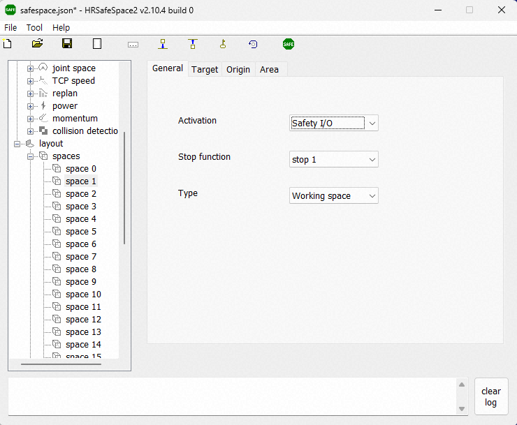</img>
<em>
space 1 일반 설정
</em>

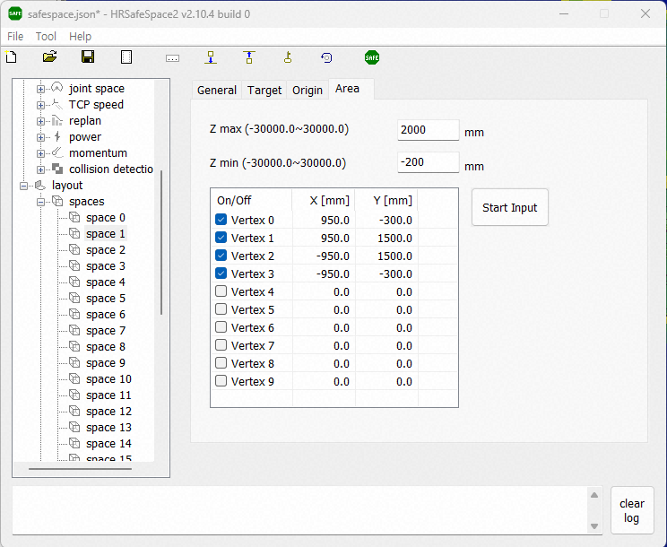</img>
<em>
space 1 영역 설정
</em>

4.3) 출구 공간의 설정 (영역 2)

HRSafeSpace2에서 Layout->spaces->space 2을 선택합니다. 
Space 2는 그림상 왼쪽 출구 공간을 설정합니다. 오른쪽 안전 매트에 사람이 있는 경우 왼쪽 출구 공간이 활성화 되며 로봇이나 툴이 이 공간을 벗어나면 로봇은 감속하여 정지합니다.

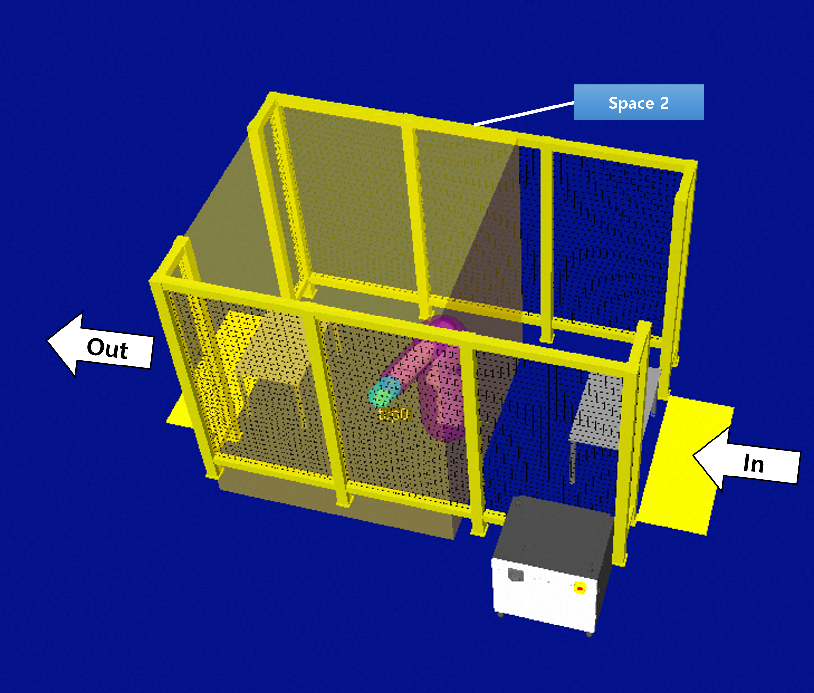</img>
<em>
space 2
</em>

[일반 탭의 설정]

|  **기능** |     **설정 값**   |   **설명**   |
| :-------: | :---------------: | :---------------: |
| 활성화 | 안전 신호 | 안전신호의 입력이 0이 되면 활성화, 1이 되면 비활성화|
| 정지 기능 | Stop 1 | 타겟이 작업공간을 벗어나면 감속 정지 후 모터오프|
| 타입 | 작업 공간 | 작업공간으로 설정|

 

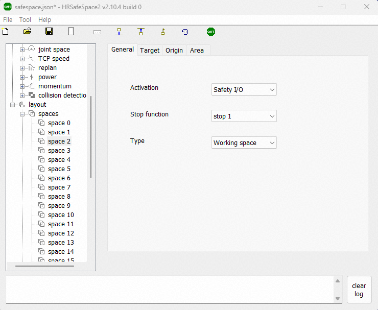</img>
<em>
space 2 일반 설정
</em>

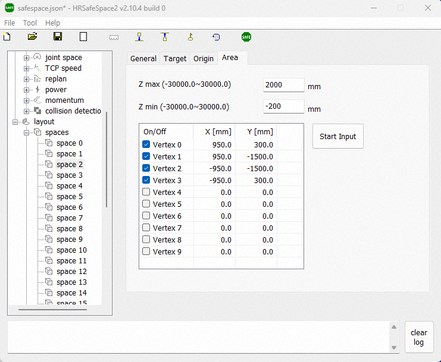</img>
<em>
space 2 영역 설정
</em>

